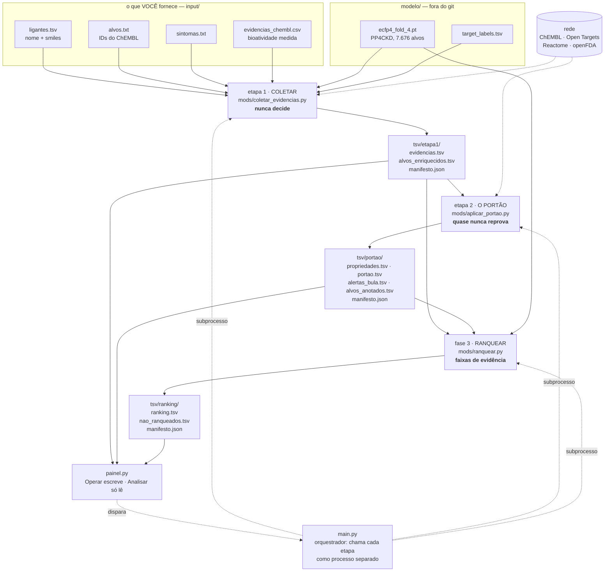

# Drogabilidade — ranqueamento de compostos por evidência de alvo

Pipeline que responde a uma pergunta: **dada uma lista de compostos e uma lista
de alvos, quais compostos têm evidência de agir sobre esses alvos, e em que
ordem?**

Três etapas, com papéis que não se misturam:

```
etapa 1  COLETAR    o que se sabe           -> nunca decide
etapa 2  O PORTÃO   o que fica marcado      -> quase nunca reprova
fase 3   RANQUEAR   a ordem usando os alvos -> faixas de evidência
```

Cada etapa publica a própria tabela com o próprio manifesto ao lado. **Tabela
sem manifesto não é citável**, e é por isso que as duas são escritas em
temporários e trocadas juntas: uma falha no meio não publica nada.

---

## Arquitetura



**Por que subprocesso, e não um processo só.** Se a fase 3 falhar, a etapa 2
continua publicada e citável. Rodar tudo num processo deixaria uma falha no
fim derrubando o que já estava pronto. O custo é carregar o checkpoint duas
vezes — e ele tem 33,8 MB.

**O painel não orquestra.** Ele lança `python main.py` como processo separado e
lê a tabela `ETAPAS` dele. Se a sequência das etapas virasse código de
interface, sairia do alcance de qualquer script.

**O único acoplamento entre operar e analisar é o sistema de arquivos.**
Execução disparada no terminal aparece no painel; execução disparada no painel
é lida por um script.

### Mapa dos módulos

| módulo | responsabilidade |
|---|---|
| `main.py` | a sequência das etapas, a retomada, o código de saída |
| `mods/caminhos.py` | onde fica cada coisa. Sem efeito colateral: nada é criado no import |
| `mods/config.py` | as 46 flags das três etapas num arquivo só, validadas |
| `mods/quimica.py` | forma parental (`Cleanup` → maior fragmento orgânico → neutralização), que é a chave de identidade |
| `mods/modelo.py` | carrega o PP4CKD e calcula o ECFP4 (Morgan r=2, 4.096 bits) |
| `mods/evidencias/` | a etapa 1: entrada, evidência medida, prevista, enriquecimento, cache de rede, manifesto, escrita atômica |
| `mods/portao/` | a etapa 2: propriedades, ADMET, bula, expressão, decisão |
| `mods/ranque/` | a fase 3: faixa, canal negativo, validação |
| `mods/openfda_massa.py` | o acervo do openFDA baixado e respondido localmente |
| `mods/painel/` | a biblioteca do painel, testável sem servidor |
| `mods/instantaneo.py` | traz os dados de origem para `input/`, com procedência |
| `mods/validar_modelo.py` | mede o preditor contra bioatividade medida (recall@10) |

---

## Início rápido

Num clone limpo:

```bash
git clone https://github.com/robertoaabfilho/druglikeness.git
cd druglikeness
python -m venv .venv && source .venv/bin/activate   # Windows: .venv\Scripts\activate
pip install -r requirements.txt
python -m pytest -q                                  # 810 testes, nenhum usa rede
```

O que **não** vem no repositório, e precisa ser trazido:

| o que falta | por que | como trazer |
|---|---|---|
| `modelo/` | 33,8 MB de pesos, não redistribuíveis daqui | `python mods/instantaneo.py --modelo-origem <pasta>` |
| `input/ligantes.tsv` | instantâneo de dezenas de MB (a última execução real: 126.240 linhas lidas → **107.123 ligantes**, 17.305 sem nome ou SMILES, 1.812 duplicadas por forma parental) | `python mods/instantaneo.py --ligantes-origem <arquivo>` |
| `input/alvos.txt`, `input/sintomas.txt` | **são seus**: o pipeline não os deduz | copie de `exemplos/` e edite |
| `input/evidencias_chembl.csv` | 60 MB de bioatividade medida | `--evidencias-origem <arquivo>` |

`input/procedencia.json` **é** versionado: ele guarda origem, data, MD5 e
contagens de cada instantâneo. Os dados saem do git; o registro deles fica.

Depois:

```bash
python main.py              # as três etapas
streamlit run painel.py     # a interface
```

Sem o modelo, a etapa 1 **degrada**: ela roda só com a evidência medida e diz
o que falta, em vez de falhar.

### Levar para outra máquina

```bash
python mods/empacotar.py --saida ../druglikeness-pacote.zip
python mods/empacotar.py --saida ... --enxuto   # só o código, sem os dados
```

**O padrão é tudo.** Se o dado existe nesta máquina, ele vai no pacote: o
código, os testes, os pesos do modelo, a base de ligantes, a evidência medida
do ChEMBL, as suas listas de alvos e sintomas, e o **acervo do openFDA
inteiro** — o índice que a etapa 2 lê e as partições que o originaram. São
alguns GB, e é o preço de a outra máquina **reproduzir** o resultado em vez de
só rodar o pipeline.

Por que o acervo tem de ir: sem ele a outra máquina cai na rede, com outro teto
de taxa e **outra data de carga** do openFDA. O manifesto registraria outra
versão de serviço — ou seja, outra execução. Reproduzir exige a mesma carga.

Duas coisas ficam fora, e nenhuma por tamanho:

- **`tsv/`** — as saídas são o resultado de uma execução *desta* máquina;
  levá-las faria a outra parecer ter rodado o pipeline.
- **`json/cache_rede/`** — o cache é indexado por versão de serviço, e servir
  cache velho do outro lado daria resposta de uma versão que não é a de lá. É
  correção, não economia.

`--enxuto` faz o pacote pequeno, por pedido explícito, e aí o que ficou fora é
registrado em `PACOTE.json` com o comando que o traz.

Em qualquer dos dois, `LEIA-ME-PRIMEIRO.md` diz como instalar, e **a suíte
verde do outro lado é o que prova que o pacote chegou inteiro** — é a primeira
coisa que o arquivo manda rodar.

---

## A árvore

```
main.py                    orquestrador das três etapas
painel.py                  interface: operar e analisar
input/                     o que VOCÊ fornece
    ligantes.tsv           instantâneo convertido da base de origem
    alvos.txt
    sintomas.txt
    evidencias_chembl.csv  evidência medida (fora do git: 60 MB)
    procedencia.json       origem, data e MD5 de cada instantâneo
mods/                      código: as etapas, as CLIs e a infraestrutura
modelo/                    pesos .pt e target_labels.tsv (fora do git)
json/
    config.json            o parâmetro de cada etapa, num lugar só
    cache_rede/<versao>/   uma subpasta por versão dos serviços
tsv/
    .execucao/ estado da execução que o painel disparou: rodando.pid,
               main.log, ritmo.csv, ultimo.json
    etapa1/    evidencias.tsv, alvos_enriquecidos.tsv, manifesto.json
    portao/    propriedades.tsv, portao.tsv, alertas_bula.tsv,
               alvos_anotados.tsv, manifesto.json
    ranking/   ranking.tsv, nao_ranqueados.tsv, manifesto.json
dados/                     dado de referência versionado, com licença própria
exemplos/                  fixtures de validação
tests/                     a suíte; nenhum teste usa rede
```

`input/` é o que você fornece; `tsv/` é o que a máquina gerou. A regra que
desempata, porque ligantes e alvos também são TSV: **procedência, não
extensão.**

## Instalação

```bash
pip install -r requirements.txt              # instala num clone limpo, sem compilador
pip install -r requirements-opcionais.txt    # pesada: torch (evidência prevista)
```

Os dois arquivos são separados porque o pip **instala toda linha que
encontrar**, comentada como "opcional" ou não.

Sem `torch`, ou sem os pesos em `modelo/`, a etapa 1 roda em **modo
degradado**: só com evidência medida, e dizendo isso. É o `main.py` que
garante isso — ele confere os caminhos do modelo antes de rodar e, se os
arquivos não estiverem lá, retira as duas chaves da linha de comando e avisa
o que fazer para trazê-los. Chamando a CLI da etapa 1 à mão com um
`--checkpoint` que não existe, você recebe erro, não modo degradado.

## Primeiro passo: o instantâneo

O pipeline **não lê nada de outro projeto em tempo de execução**. O que vem de
fora entra uma vez, como instantâneo datado, com origem e MD5 gravados em
`input/procedencia.json`:

```bash
python mods/instantaneo.py \
    --ligantes-origem CAMINHO/atividades_compostos.csv \
    --evidencias-origem CAMINHO/evidencias_chembl.csv \
    --modelo-origem CAMINHO/models
```

Isso não é zelo. A base de compostos de origem pode estar sendo **escrita por
uma execução em curso** — o `_parcial` no nome dela é literal. Lida em tempo de
execução, a lista de ligantes mudaria debaixo do pipeline, e duas etapas da
mesma execução poderiam ver conjuntos diferentes. Linha truncada é **contada e
nomeada** (código 3), nunca somada ao bolo de "sem SMILES utilizável".

### Alvos e sintomas são seus

O instantâneo traz os ligantes e a evidência medida. **`input/alvos.txt` e
`input/sintomas.txt` são escolha sua** — é o que define a pergunta —, e nenhuma
ferramenta os cria. Para começar, copie um exemplo versionado:

```bash
cp exemplos/alvos.dor_neuropatica.txt input/alvos.txt
cp exemplos/sintomas.dor_neuropatica.txt input/sintomas.txt
```

O `main.py` confere esses caminhos **antes** de rodar qualquer etapa, e diz
quais faltam. Sem essa conferência, a etapa 1 leria os 107 mil ligantes antes
de abrir o arquivo de alvos, e o "arquivo não encontrado" chegaria depois de
minutos de RDKit.

A conversão recalcula dois InChIKeys: o da molécula como está e o da **forma
parental** (*Cleanup → maior fragmento orgânico → neutralização*). A parental é
a identidade: é ela que reconhece que sal e base livre são o mesmo composto, e
é por ela que a deduplicação acontece.

> **O `.pt` e o `target_labels.tsv` têm de ser do mesmo PP4CKD.** A coluna *i*
> de um não é o alvo *i* do outro, e pontuar assim atribuiria a probabilidade
> de um alvo ao nome de outro. Por isso o instantâneo copia os dois juntos, e a
> etapa 1 **recusa** um par cuja largura de saída do checkpoint não seja o
> número de rótulos.

## Rodar

```bash
python main.py                       # as três etapas, da primeira à última
python main.py --retomar             # pula etapa cuja saída já existe
python main.py --a-partir-de portao  # começa numa etapa
python main.py --somente ranking     # roda só uma
python main.py --sem-instalar        # confere o ambiente e não instala nada
```

### A partida confere o ambiente

Antes de qualquer etapa, o orquestrador verifica as dependências e **instala o
que falta** — pelo `pip` do interpretador corrente (`sys.executable -m pip`,
nunca o `pip` do PATH, que pode ser de outro ambiente), usando a linha do
`requirements.txt` e não só o nome do pacote: instalar `numpy` onde o arquivo
pede `numpy>=2` satisfaria o nome e não a restrição.

Ele **diz antes de instalar**, e depois **confere de novo** — instalou e o
pacote continua ausente é falha, não sucesso. Se o ambiente continuar
incompleto, para com código 2: nenhuma etapa roda com biblioteca faltando,
porque ela quebraria no meio, depois de horas.

Duas coisas que ele **não** faz:

- **não instala as opcionais.** `torch` são alguns GB, e o pipeline *degrada*
  sem ele: a etapa 1 roda só com evidência medida e a fase 3 deixa o canal
  negativo `indeterminado`, nunca 0. O que a partida faz é dizer o que a falta
  **desliga** — baixar GB sem pedir seria decidir por você num ponto em que
  você tem alternativa;
- **não mexe no que já está instalado.** Sem `--upgrade`: a tarefa é suprir o
  que falta, não atualizar o que funciona.

`--sem-instalar` é para ambiente compartilhado, automação ou máquina sem rede:
confere, diz o que falta, e para. O painel também **não instala** — mostra o
estado na barra lateral e o comando, porque instalar por clique mexeria no
ambiente de quem abriu a aba.

**Nada é implícito.** Sem `--retomar`, tudo roda — pular etapa cuja saída
existe é economia legítima, mas feita por omissão ela entrega resultado velho
como novo, e num pipeline cuja execução real são ~23 milhões de pares ninguém
notaria.

E `--retomar` **confere a entrada**, não só a existência da saída: ele lê
`versoes.ligantes_md5` do manifesto daquela etapa e compara com o arquivo que
a configuração aponta. Se não bate, a entrada mudou desde que aquela etapa
rodou, e ele **refaz** a etapa — aproveitar a saída misturaria duas execuções
numa, e abortar mandaria você recomeçar ~23 milhões de pares por algo que o
orquestrador pode refazer. Se o manifesto não registra o MD5, a conferência
sai `indeterminado` e a etapa roda de novo.

| código de saída | significa |
|---|---|
| 0 | execução completa |
| 3 | **parcial**: a saída existe, mas linhas de entrada foram descartadas |
| 1 | nenhuma entrada utilizável (nada é escrito) |
| 2 | erro (nada é publicado; as saídas anteriores ficam intactas) |

O `main.py` devolve o **pior** código entre as etapas que rodou. O 3 existe
porque automação não lê o `stderr`.

## O painel

```bash
streamlit run painel.py
```

Duas abas, e a separação é deliberada:

- **Operar** escreve. As três entradas (upload grava em `input/` e **diz o que
  substituiu**, com o MD5 de antes e de depois), a revisão da lista de alvos
  enriquecidos, os parâmetros de cada etapa (cada número com a medição que o
  escolheu ao lado, vinda do `_nota_*` do `config.json`), e o disparo: quais
  etapas, com ou sem `--retomar`.
- **Analisar** **só lê**. As tabelas publicadas em `tsv/` — ranking com filtro
  por faixa e por alvo, não ranqueados com o motivo, portão, propriedades,
  alertas de bula com o trecho literal, alvos anotados com expressão, e as
  evidências da etapa 1 — e o **manifesto da etapa** de cada uma. Tabela sem manifesto aparece com um
  aviso de que não é citável; ela não é escondida.

Isso evita o acidente de mexer num parâmetro enquanto se interpreta um
resultado e depois não saber qual número gerou o quê.

**O painel não decide nada.** Marcar, reprovar, ordenar e enriquecer ficam nas
etapas; a sequência das etapas fica no `main.py`, de onde o painel a lê. Ele
também não reimplementa o orquestrador: o botão "Rodar" lança
`python main.py` como processo separado.

**A execução sobrevive ao fechamento da aba.** O processo sai do grupo do
Streamlit, e o painel o reencontra pelo `tsv/.execucao/rodando.pid`, que guarda
o PID e o instante de início. Reabrir o painel (ou abrir numa segunda aba)
mostra a execução em curso, com o log e o **ritmo observado** — taxa medida,
não barra de progresso: o total depende de quantos pares sobrevivem a cada
filtro, e uma barra assim seria invenção apresentada como medida.

Enquanto uma etapa roda, a tabela dela ainda não existe (a publicação é
atômica). O que o painel mostra é uma **cópia do temporário**, sempre sem a
última linha, que pode estar cortada no meio de um campo.

Para parar uma execução, use o botão **Encerrar** da aba Operar: ele manda
`SIGTERM`, e a etapa publica por troca de nome, então o resultado anterior fica
intacto. Ao terminar — por conta própria ou encerrada —, o painel **colhe o
processo** e mostra o código de saída (0 completa, 3 parcial, 1 nada
aproveitável, 2 erro).

Duas abas não lançam duas execuções: a tranca `tsv/.execucao/rodando.pid` é
criada com exclusividade antes do processo existir, e a segunda aba encontra a
primeira e recusa. **Não apague essa tranca com uma execução de pé** — é o
caminho para ter dois `main.py` escrevendo as mesmas saídas. Se o painel
insistir que há execução quando não há (um PID reciclado pelo sistema), o
arquivo expira em 24 h; apagá-lo à mão só é seguro com o pipeline parado.


## A configuração

`json/config.json` tem uma seção por etapa, e cada chave é o nome da flag da
CLI daquela etapa. **Chave desconhecida é erro (código 2)**, nunca ignorada em
silêncio: uma política que o pesquisador acredita estar valendo e não está é
pior que uma mensagem de erro. Chave ausente não entra na linha de comando — a
CLI aplica o próprio padrão, que é onde os padrões moram.

Uma chave que comece com `_` é comentário. É assim que o arquivo carrega, ao
lado de cada número, a medição que o escolheu.

**CPU é o padrão em todas as etapas.** Medido na etapa 2: 36 de 312 colunas
diferem entre duas execuções de GPU, e 0 de 312 entre duas de CPU.

## As três etapas

### Etapa 1 — coletar (`mods/coletar_evidencias.py`)

Transforma ligantes, alvos e sintomas em `evidencias.tsv`. Uma linha é **uma
evidência** sobre um par ligante/alvo: um par com três ensaios medidos e uma
previsão são quatro linhas.

A regra que não pode ser ignorada: **`pchembl` é a única coluna de evidência
medida.** Previsto nunca se mistura com medido.

Opcionalmente enriquece a lista de alvos (Open Targets com escore ≥ 0,4;
Reactome por via, com teto de 150 proteínas). Sintoma → EFO **nunca é escolhido
em silêncio**: sem `--efo`, o sintoma não é enriquecido e a CLI pede a escolha.

O alvo que o enriquecimento acrescenta e que está **fora do espaço do modelo**
(os 7.676 alvos do PP4CKD) **entra na lista**, marcado `no_modelo = não`. Ele
recebe evidência **medida** — que ranqueia em `1b`, acima de qualquer previsão
— e **não** recebe prevista: o preditor não tem saída para ele, e a coluna
`observacao` da linha diz isso, para que zero previsões não seja lido como
"sem atividade". Quanto do espectro fica fora do modelo sai medido no
manifesto (`contagens.teto_do_modelo`; veja *Limitações conhecidas*).

Entrar na lista **não é ser ranqueado**: a fase 3 separa procedência por
sub-faixa, e alvo do enriquecimento só alcança `1b`, `2b` ou `3` — nunca as
faixas do alvo que você declarou. É isso que torna seguro coletar largo.

### Etapa 2 — o portão (`mods/aplicar_portao.py`)

O nome descreve a posição na linha, não a severidade. **Por padrão só duas
coisas reprovam**: SMILES que o RDKit não lê (não há molécula para avaliar) e
alerta forte de bula (0 de 6 falsos positivos medidos no controle).

Isso não é timidez — é o que a medição manda. No conjunto-controle de 12
fármacos, cada critério plausível de exclusão apaga os próprios positivos de
referência: PAINS reprovaria a **amitriptilina**; BRENK, **65% da base**;
expressão abaixo de 1 TPM, **SERT (0,454) e NET** — os alvos da duloxetina e da
amitriptilina. Com `--reprovar alerta_estrutural`, o controle de 12 perde 8 — e
continua aprovando o ciprofloxacino, que *causa* a condição.

Três regras atravessam a etapa:

1. **`indeterminado` nunca tira um ligante**, com política nenhuma. Ausência de
   dado não é evidência de problema.
2. **Critério que a execução não pediu sai `indeterminado`, nunca `passa`.**
   "Não perguntei" não é a mesma afirmação que "sem alerta".
3. **Nada desaparece em silêncio.** Reprovado continua na tabela, com o
   critério e o valor que decidiram.

### Fase 3 — ranquear (`mods/ranquear.py`)

A ordem vem de uma chave lexicográfica — **classe de evidência, procedência do
alvo, valor** — sem nenhuma constante arbitrada:

| faixa | quem cai nela | o que ordena dentro |
|---|---|---|
| **1a** | medida em alvo **seu** | `max pchembl` |
| **1b** | medida em alvo do enriquecimento | `max pchembl` |
| **2a** | só prevista, alvo **seu** | `max p × (1 − p_negativo)` |
| **2b** | só prevista, alvo do enriquecimento | idem |
| **3** | nenhuma evidência em alvo afirmativo | **não ranqueia** |

O antialvo não é declarado, é **deduzido**: alvo não afirmativo ∧ organismo ≠
*Homo sapiens* ∧ ≥ 50 moléculas de treino ∧ não é ortólogo de um alvo
afirmativo.

`nao_ranqueados.tsv` **não tem coluna `posicao`** de propósito: uma coluna
vazia convidaria a ordenar aquela tabela como se fosse ranking.

---

## O acervo do openFDA

`alerta_bula` é um dos **dois únicos critérios que reprovam** no portão. Pela
rede ele é limitado pela taxa do serviço público: 108.935 ligantes × 3
requisições a 240/min dariam ~23 h, e por isso `--limite-bula` existe com
padrão 500 — o que faz o critério sair `indeterminado` para **99,5% da base**.

Com o acervo baixado, a consulta é local e **não há taxa**:

```bash
# ~1,7 GB em 14 partições, mais ~2 GB de índice. Retoma: interromper é seguro.
python mods/openfda_massa.py --baixar --indexar --saida dados/openfda

# ou, num comando só, antes de rodar o pipeline:
python main.py --baixar-acervo
```

Depois, aponte a configuração para ele — `portao.acervo_bula` em
`json/config.json` — e o teto de taxa deixa de valer. Vazio, o pipeline usa a
rede com `--limite-bula`.

### Noutra máquina: verifica sempre, baixa se você pedir

Se a configuração aponta um acervo que **não existe**, o orquestrador diz isso
**antes de qualquer etapa**, com o comando que resolve. Não depois de horas,
quando a etapa 2 começa.

O download **não** é automático, e a razão é a mesma do `torch`:
são ~3,7 GB e ~20 min, existe alternativa (a rede, com o teto), e **para uma
base de produto natural o acervo compra pouco** — medido, 58 de 60 ligantes de
exemplo não têm bula nenhuma. Baixar GB como efeito colateral de rodar o
pipeline seria decidir por você num ponto em que você tem escolha. `--baixar-
acervo` existe para quando a escolha é sua.

**Como isto funciona sem reescrever o critério.** O acervo responde as *mesmas
URLs* que `mods/portao/bula.py` monta. O módulo da bula não muda uma linha: ele
recebe outro `obter_json`, e toda a lógica medida continua valendo — a janela
de 50 bulas por data decrescente, a consulta dirigida sobre o acervo inteiro, e
o desconto da indicação, que é o que leva o controle de 12 fármacos a **0 de 6
falsos positivos** no grupo que trata.

Três recusas deliberadas:

- partição truncada é **refeita** na retomada, não aceita — aceitá-la daria um
  acervo incompleto apresentado como completo, e `indeterminado` virando "sem
  alerta" para o ligante cuja bula estava naquela partição;
- URL de outro endpoint levanta erro que a **nomeia** — responder vazio faria
  uma consulta nova sair "sem alerta" calada;
- a busca por termo é por **palavra inteira**, como na rede.

`--acervo-bula` com `--sem-rede` é **erro**, não escolha silenciosa: o acervo
responde as consultas, e `--sem-rede` diz para não consultar. A versão do
acervo (a data da carga do openFDA) entra no manifesto e nas chaves da
repetição — duas execuções com acervos de datas diferentes não são a mesma
execução.

### O acervo remove o teto de taxa — não o de cobertura

**Medido com o acervo real** (export de 2026-11-27, 265.130 bulas), sobre os
60 ligantes de `exemplos/ligantes.exemplo.tsv`:

| veredito de `alerta_bula` | ligantes |
|---|---|
| `indeterminado` — **sem bula nenhuma no openFDA** | 58 |
| `passa` — tem bula, nenhum termo | 2 |
| `marca` / `reprova` | 0 |

Só *Schisandrin B* e *Baicalin* têm rotulagem. Os outros 58 são produtos
naturais, e o openFDA é **rotulagem de fármaco dos EUA**: o documento não
existe.

Então o acervo entrega o que prometia — o critério pode rodar sobre os 107.123
ligantes, sem taxa — e **não** faz `alerta_bula` passar a agir sobre uma base
de produto natural, porque ali o limite não é quantas consultas cabem, é
quantos compostos têm bula. `indeterminado` por falta de documento é a resposta
**certa**: ausência de documento não é ausência de risco.

Onde o acervo muda o resultado é na parte da base que **tem** rotulagem — e a
validação contra a API confirma que ali ele responde igual: `ciprofloxacin`
118 de 166 bulas em seção forte, `capsaicin` 211 bulas com a indicação
descontando o alerta, `duloxetine` 126 ocorrências fortes e ainda assim
`passa`, porque é indicada para a condição.

**O que o acervo NÃO resolve:** a negação em texto livre. Uma bula que diga
"não há relatos de neuropatia" ainda casa o termo. É por isso que a etapa 2
expõe o **trecho literal**, com a seção e as duas contagens (a da janela e a do
acervo inteiro), em vez de só um sinalizador.

---

## Windows

O pipeline roda em Windows. Esta seção separa **o que foi verificado** do que
não foi — a distinção importa, porque um "é compatível" sem qualificação não
vale nada.

```
python -m venv .venv
.venv\Scripts\activate
pip install -r requirements.txt
python -m pytest -q
```

### O defeito grave que a auditoria encontrou

No Windows, **`os.kill(pid, 0)` não consulta: ele chama `TerminateProcess`.**
O painel pergunta "esta execução está viva?" a cada 2 segundos, pelo fragmento
de acompanhamento — no Windows isso **mataria a execução do pipeline**. A
consulta agora é `OpenProcess` + `GetExitCodeProcess`, e só ela
(`mods/painel/execucao._vivo_nt`).

### O que foi corrigido, com teste

| risco | o que acontecia | agora |
|---|---|---|
| vivacidade do processo | `os.kill` matava a execução | `OpenProcess` + `GetExitCodeProcess` |
| destacar o processo | `start_new_session` é `setsid`, não existe | `CREATE_NEW_PROCESS_GROUP \| DETACHED_PROCESS` |
| encerrar | `SIGTERM` virava kill por acidente de portabilidade | `TerminateProcess` pelo caminho explícito |
| **tabela aberta no Excel** | `os.replace` levanta `PermissionError`, e no meio do laço deixava **tabela sem manifesto** | os destinos são conferidos **todos antes** de trocar qualquer um; nada é publicado, e a mensagem nomeia o arquivo e a causa |
| URI do SQLite | `C:\x\y.sqlite` não é URI válida | `Path.as_uri()` |
| nome vindo do openFDA | `drug/label (part 1 of 14)` escapava da pasta | nome vem da URL, higienizado |
| fim de linha | CRLF deixaria `\r` no último campo | escritor e leitor usam `newline="\n"`; a entrada do usuário é lida com `csv`/`newline=""` e `utf-8-sig`, que come o BOM do Notepad |
| página de código | `print` sem encoding declarado | toda leitura de texto declara `encoding="utf-8"` |
| `python` do PATH | podia ser outro ambiente | `sys.executable` |

E quatro guardas sobre os nomes de arquivo, porque o pacote descompacta no
Windows: nenhum caminho passa de 200 caracteres (260 menos 60 de reserva para
a raiz de descompactação), nenhum nome tem `< > : " | ? *`, nenhum é nome
reservado (`CON`, `NUL`, `COM1`…), e nenhum colide por caixa.

### O que NÃO foi verificado, e por quê

Os testes de `tests/test_windows.py` exercitam o **caminho** do Windows nesta
máquina Linux, por substituição. Eles pegam erro de lógica e de API — foi assim
que o `os.kill` apareceu — e **não substituem rodar a suíte num Windows de
verdade**. Fica sem verificação: o comportamento real do sistema de arquivos
sob travamento, a página de código do console, e a instalação do RDKit e do
PyTorch pelo pip naquele sistema.

Se você rodar a suíte num Windows e algo falhar, a falha é informação sobre
esta lista — não sobre o seu ambiente.

### Uma recomendação concreta

Deixe `--workers 0` (o padrão). Ele vai para o `DataLoader` do ADMET-AI, e no
Windows o início de processo é por `spawn`, que reimporta o módulo — com 0 não
há processo filho nenhum e a questão não existe.

---

## Testes

```bash
python -m pytest -q
```

Nenhum usa rede — a fixture `sem_rede` bloqueia socket de internet e falha o
teste que tentar. E **nenhum depende do checkpoint real nem do
`target_labels.tsv`**, que não estão no repositório: os rótulos são sintéticos
e as probabilidades do controle são uma fixture gravada. Consequência
registrada em `tests/dados/LICENSE`: essa fixture fixa a **aritmética**, não o
modelo.

`tests/test_ranque_auc.py` prende os números que decidiram o desenho — 0,750
sem canal negativo, 0,806 com ele, e 0,583 da contagem de promiscuidade que foi
**descartada** — para que o desenho rejeitado não volte.

`tests/test_sem_fluxo_antigo.py` é a guarda da reestruturação: nenhum arquivo
da árvore pode mencionar os módulos do pipeline anterior, e nada que rode pode
apontar para a pasta de outro projeto.

## Limitações conhecidas

- **O ganho do canal negativo NÃO foi confirmado fora do conjunto que o
  originou.** Medido sobre 222 compostos independentes (156 `trata` / 66
  `causa`): AUC **0,484** com canal e **0,484** sem — nível de azar. O 0,806 do
  controle de 12 era número de **treino**: a regra foi escolhida por maximizar
  a AUC naquele conjunto, entre cinco candidatas.
  - **O diagnóstico, que importa mais que o número:** a mediana de
    `p_afirmativo` naquele conjunto é 0,0012 (`trata`) e 0,0016 (`causa`) —
    produtos naturais não atingem os alvos das drogas de referência
    sintéticas, então não havia sinal para ordenar e 0,48 mede ruído. Com o
    corte padrão, só **19 dos 222** recebem evidência, e os outros 203 vão para
    `nao_ranqueados.tsv` como faixa 3 — a resposta **certa**.
  - **O que generalizou:** o **QED fica em 0,384, abaixo do azar**, ordenando
    os causadores à frente em dados independentes. É a premissa que motivou
    ranquear por faixa de evidência em vez de por semelhança química.
- **O enriquecimento por grafo não melhora o ranqueamento no corte padrão.**
  AUC 0,6146 usando só os alvos pedidos contra 0,5145 usando os 274 do
  enriquecimento. O grau no grafo é **detector de hub, não de relevância**: o
  topo é Calmodulina-1 (17 sementes) e quatro subunidades de CaMKII (14). Por
  isso `via_origem` e `alvo_semente` são rastro de auditoria e não entram em
  comparação de ranqueamento.
- **O gargalo não é o desenho do escore, é n.** Com 19 a 70 compostos
  ranqueáveis, a divisão em metades já põe 9 e 13 de cada lado.
- **A checagem de bula não entende negação em texto livre.** Uma bula que diz
  "não há relatos de neuropatia" ainda casa o termo. É por isso que a etapa 2
  expõe o **trecho literal** em vez de só um sinalizador: o trecho sinalizado
  precisa de revisão humana.
- **A checagem de bula tem dois tetos, e o acervo só remove um.** Pela rede, o
  teto é de **taxa**: `--limite-bula` (padrão 500) sobre 108.935 ligantes faz
  o critério que mais reprova sair `indeterminado` para 99,5% da base. Com
  `--acervo-bula` esse teto deixa de existir. O que **fica** é o teto de
  **cobertura**: medido com o acervo real, 58 dos 60 ligantes de exemplo não
  têm bula nenhuma no openFDA — são produtos naturais, e o openFDA é rotulagem
  de fármaco dos EUA. Para uma base assim, `alerta_bula` continua
  majoritariamente `indeterminado`, e isso é **correto**: ausência de documento
  não é ausência de risco. Veja *O acervo remove o teto de taxa — não o de
  cobertura*.
- **O percentil de toxicidade não está validado neste conjunto** — é por isso
  que `toxicidade` só marca, nunca reprova, por padrão.
- **A direção farmacológica do alvo (silenciar vs modular) não entra em nada**,
  e não pode: `pchembl` colapsa EC50, Ki, IC50 e AC50 numa coluna só, e o canal
  previsto é P(ativo), sem direção.
- **A faixa permeável não foi medida.** Hoje a faixa é estrita: medido sempre
  antes de previsto. Deixar uma previsão muito forte subir de faixa exigiria um
  limiar que n = 12 não calibra.
- **O espectro de alvos tem um teto que nenhum corte ajusta:** o espaço do
  modelo. Alvo fora dos 7.676 do PP4CKD **entra na lista**, marcado
  `no_modelo = não`, e recebe evidência **medida** (ChEMBL) — que ranqueia nas
  faixas `1a`/`1b`, acima de qualquer previsão. O que ele não recebe é
  evidência **prevista**: o preditor não o pontua, e zero previsões para ele
  significa "não foi pontuado", não "sem atividade".

  Antes, o alvo que o Reactome alcançava e estava fora do modelo era
  **descartado** — era a maior perda do enriquecimento, e corrigia-se uma
  assimetria ao remover o descarte: declarar protegia e enriquecer não (alvo do
  usuário fora do modelo ficava, alvo do Open Targets fora do modelo ficava, e
  só o do Reactome saía).

  **O teto agora é medido a cada execução**, na chave
  `contagens.teto_do_modelo` do `manifesto.json` da etapa 1:

  | chave | o que diz |
  |---|---|
  | `alvos_fora_do_modelo` | quantos alvos o modelo não cobre |
  | `alvos_fora_com_evidencia_medida` | desses, quantos ranquearam por medida — **não custaram nada** |
  | `alvos_fora_sem_evidencia_medida` | desses, quantos ficaram sem evidência nenhuma — **é o que retreinar o preditor recuperaria** |
  | `pares_previstos_perdidos` | a mesma perda em pares ligante × alvo |
  | `dobrados_por_familia` | alvos dobrados no representante da classe, que de outro modo desapareceriam da conta |
  | `alvos_ambiguos` | nome que casa com mais de um alvo do modelo: **indecidível sem o ID**, e não prova de que o modelo não cobre o alvo |
  | `alvos_marca_ausente` | alvos cuja situação **não se sabe**: a lista não trazia a coluna `no_modelo` e a execução rodou sem o modelo em mãos (`--rotulos`). Não é zero nem "dentro" — é indeterminado, e aparece como tal |
  | `alvos_marca_divergente` | a lista dizia uma coisa e os rótulos em mãos dizem outra. Quando os rótulos estão presentes **eles decidem** (são *este* modelo; a marca registra o que algum modelo anterior cobria), e a divergência fica contada |

  Quem decide dentro/fora é `casar_alvos` — a **mesma** função que decide o que
  o preditor pontua —, então um alvo declarado por `alvo + organismo` sem ID é
  resolvido como o preditor o resolve. E `alvos_fora_com_evidencia_medida` só
  conta medida com `pchembl` finito: uma triagem qHTS ou um limite `>` não
  ranqueia, e contá-la como recuperada esconderia uma perda real.

  Para o teto sair medido, a etapa 1 precisa de `--rotulos`. Sem ele, os alvos
  caem em `alvos_marca_ausente` e o número não é uma medida.

  **O teto é medido sobre a lista que a evidência usou (`--alvos`).** Na
  execução que *faz* o enriquecimento, essa lista é a sua — pré-enriquecimento
  —, então o teto dela não vê o que o enriquecimento acrescentou. Por isso o
  manifesto traz também `contagens.teto_da_lista_enriquecida`, medido sobre a
  lista que aquela execução escreveu, e `contagens.reactome_fora_do_modelo_entraram`,
  que é quantos alvos fora do modelo o Reactome trouxe.

  É esse número — medido na sua execução, não citado de uma execução antiga —
  que diz se retreinar compra alguma coisa. Sem ele, retreinar é opinião.

  **Medido em 2026-11-27** (Open Targets 26.09, ChEMBL 37, Reactome 98), para
  `neuropathic pain` = `EFO_0005762` com os 10 alvos de
  `exemplos/alvos.dor_neuropatica.txt`:

  | | alvos | no modelo | fora do modelo |
  |---|---|---|---|
  | você declarou | 9 | 9 | 0 |
  | Open Targets acrescentou | 22 | 20 | 2 |
  | Reactome acrescentou | 423 | 243 | **180** |
  | **total** | **454** | **272** | **182** |

  Os **180 alvos do Reactome fora do modelo** são exatamente os que o fluxo
  anterior **descartava** — 40% do que o Reactome traz. Eles entram marcados,
  recebem evidência medida e não recebem prevista; a perda de pares previstos
  é 182 × (nº de ligantes).

  **Os números antigos (259 proteínas, 61 fora do modelo) não se reproduzem, e
  não é defeito:** foram medidos contra Open Targets 24.09 e ChEMBL 35. Open
  Targets, ChEMBL e Reactome são atualizados, e os escores de associação e as
  vias mudam com eles. É precisamente por isso que o teto virou **instrumento**
  em vez de número citado — e por que a versão de cada serviço vai no
  manifesto.

## Licenças

Código sob MIT (`LICENSE`). Dado derivado do ChEMBL é **share-alike** e tem
licença própria ao lado, em `dados/LICENSE` e `tests/dados/LICENSE`. Ao
publicar resultados, cite as bases de origem.
